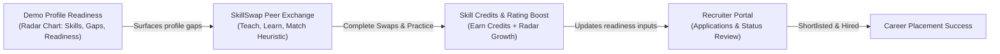

# 🚀 Skill-TERN

> **"Identify your skill gaps → Swap skills with peers to master them → Earn credits and boost your readiness → Get matched with internships."**

**Skill-TERN** is a hackathon prototype that connects student peer-to-peer skill exchange with internship applications and recruiter review. Its current match score is a deterministic, explainable heuristic; it does not call an AI service.

Internship profile-fit estimates combine a role baseline (30%), profile readiness metrics (40%), listed-skill overlap (20%), and a completed-swap bonus of 2 points per swap up to 10 points. The result is clamped to 65–99; it is a demo sorting aid, not an AI prediction or hiring recommendation.

---

## 💡 The Problem & Unified Value Proposition

Traditional placement portals tell students what they lack (*"Missing skills: Docker, System Design, Mock Interview practice"*) but offer no way to solve the gap.

**Skill-TERN closes that loop:**
1. **Review Readiness:** A demo radar summarizes profile inputs across resume, skills, projects, interview readiness, consistency, and internship fit. Most inputs are seeded or self-reported.
2. **Swap Skills with Peers (SkillSwap Engine):** Students find peer mentors to exchange knowledge, practice mock interviews, and work on real-world projects.
3. **Earn Skill Credits & Boost Readiness:** Completing an accepted swap awards credits and updates selected collaboration-related readiness metrics.
4. **Apply & Review:** Students apply to open roles; recruiters can review applications for roles they posted and update application status.



---

## ✨ Features

### 🎓 Student & Peer Area
- **Interactive Profile Radar:** Displays seeded/profile metrics for resume, skills, projects, interview readiness, consistency, and internship fit.
- **Profile Insights:** Rule-based suggestions link to peer discovery; they are not generated by an AI model.
- **Peer Matching:** Calculates compatibility from the overlap between learning and teaching lists.
- **Skill Swap Workflows:** Propose swaps, accept/reject requests, and track active collaborations.
- **Swap Chat:** The client polls accepted-swap conversations every three seconds.
- **Skill Wallet:** New accounts receive 100 starter credits. Completing a swap awards a net 5 credits and records the session ledger entries.
- **Internship Explorer:** Browse open roles with a heuristic score using role base score, profile metrics, required-skill overlap, and completed swaps.
- **Application Tracking:** Displays application statuses (`applied`, `reviewing`, `shortlisted`, `rejected`, `accepted`).

### 💼 Recruiter Portal
- **Candidate Review:** Review candidate profile metrics, match scores, and completed platform swaps.
- **Post Placements & Internships:** Custom duration, stipend, required skills, and requirements.
- **Shortlist Management:** Recruiters manually shortlist, make offers, or archive applications for their own roles.
- **Status Management:** Shortlist, extend offers, or archive applications.
- **Engineering Skill Catalog:** 65 peer-swap topics spanning mathematics, computing, electrical/electronics, mechanical, civil, chemical, engineering tools, and career practice.

---

## 🛠️ Tech Stack

| Layer | Technology |
|---|---|
| **Frontend** | React 18, TypeScript, Tailwind CSS, Recharts, Vite |
| **Backend** | Node.js, Express.js |
| **Database** | Supabase Postgres for shared deployments, or persistent local JSON storage for single-process demos |
| **Authentication** | JWT (JSON Web Tokens), bcryptjs; ERP/HR IDs are profile fields, not externally verified |
| **Validation & Uploads** | express-validator, multer |
| **Build & Tooling** | Vite, concurrently, PostCSS |

---

## 🔑 Demo Login Credentials

All demo accounts accept password **`Password123`** (or role-specific passwords `student123` / `recruiter123`):

| Role | Name | Email | Username | Self-reported ERP / HR ID | Password |
|---|---|---|---|---|---|
| **Student** | Anchal Singh | `anchal@skillswap.dev` | `anchal` | `ERP202601` | `Password123` |
| **Student** | Gargi Bothara | `gargi@skillswap.dev` | `gargi` | `ERP202602` | `Password123` |
| **Student** | Shreya Ashtekar | `shreya@skillswap.dev` | `shreya` | `ERP202603` | `Password123` |
| **Student** | Shravani Deshmukh | `shravani@skillswap.dev` | `shravani` | `ERP202604` | `Password123` |
| **Student** | Demo Student | `student@skilltern.com` | `student` | `ERP202600` | `student123` |
| **Recruiter** | Sarah Connor (Tech Corp) | `recruiter@skilltern.com` | `recruiter` | `HR202601` | `recruiter123` |

Demo accounts are available from the collapsible **Demo logins** control on the login page.

> **Prototype scope:** The seeded accounts, profile ratings, radar metrics, and recruiter listings are demonstration data. Registration does not verify an ERP ID with an institution. Do not use this prototype for real hiring decisions or real user data.

---

## 🚀 Getting Started

### 1. Install Dependencies
```bash
# Install root (frontend + tooling) dependencies
npm install

# Install server dependencies
cd server && npm install && cd ..
```

Create the API environment file and set a local JWT signing secret:

```bash
cp server/.env.example server/.env
```

### 2. Database Setup
Local runs persist data in `server/data/db.json` and seed demo users, listings, and skills when the database is empty. The engineering skill catalog is added to existing demo databases without deleting accounts. To connect Supabase, run [`supabase/migrations/20261102000000_skilltern_documents.sql`](supabase/migrations/20261102000000_skilltern_documents.sql) in the Supabase SQL Editor, then set `SUPABASE_URL` and a server-side `SUPABASE_SECRET_KEY` in `server/.env`. On its first run, an empty Supabase project is initialized from existing local demo data. Production mode requires Supabase. `/api/health` reports the active storage mode.

`npm run seed` resets and recreates the demo dataset, so use it only when you intend to replace the current local demo data:
```bash
npm run seed
```

### 3. Run Locally in Development
Runs both the Express API (Port 5001) and Vite React Frontend (Port 5173 with proxy):
```bash
npm run dev
```
Open **`http://localhost:5173`** in your browser.

### 4. Build & Production Start
Builds the React application and serves both frontend and API from a single Node process:
```bash
npm run build
npm start
```
Open **`http://localhost:5001`** in your browser.

---

## 📡 API Endpoints Summary

### Authentication & Users
- `POST /api/auth/register` — Create student or recruiter account with optional ERP ID + 100 starter credits
- `POST /api/auth/login` — Sign in via Email, Username, or ERP ID
- `GET /api/auth/me` — Current authenticated user
- `GET /api/users/matches` — Dynamic peer compatibility matching
- `GET /api/users` — Search and filter peers

### Skill Swaps & Chat
- `GET /api/skills` — Subject & skill catalog
- `POST /api/swaps` — Propose swap request
- `GET /api/swaps/received` — Pending incoming requests
- `GET /api/swaps/active` — Active collaborations
- `PUT /api/swaps/:id/accept` — Accept swap
- `PUT /api/swaps/:id/complete` — Complete swap (+5 credits & radar score boost)
- `GET /api/messages/:userId` — Fetch chat thread
- `POST /api/messages` — Send message

### Internships & Applications
- `GET /api/internships` — Open listings with student-specific heuristic match scores
- `POST /api/internships` — Post new internship (Recruiter)
- `POST /api/internships/:id/apply` — Apply with readiness score and completed-swap count
- `GET /api/internships/student/my-applications` — Track student applications
- `GET /api/internships/recruiter/all-applications` — Review candidate applications

### Wallet
- `GET /api/wallet` — Balance and transaction history

---

## 📄 License
MIT © 2026 Skill-TERN
