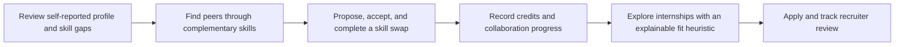
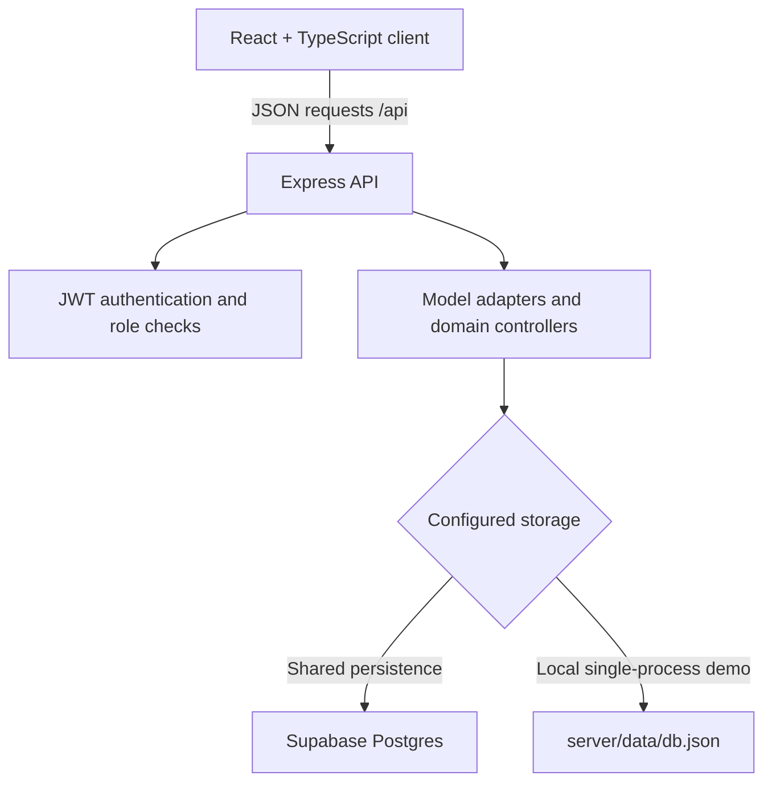

# Skill-TERN

### Turn engineering skill gaps into peer practice—and carry that progress into internship applications.

Skill-TERN is a peer-learning and internship-readiness prototype for engineering students. It connects four steps that are usually scattered across different tools: understand what you want to improve, find a peer who can teach or learn it, complete a focused skill exchange, and explore internships with your new practice reflected in your profile.

**The central idea:** a readiness dashboard is more useful when it leads to a concrete way to improve.

---

## The product loop



## What you can do

### As a student

- Review a profile-readiness radar across skills, projects, interview practice, consistency, and related profile signals.
- Browse peer profiles and see compatibility based on the skills each person wants to learn and can teach.
- Propose, accept, reject, and complete skill swaps; accepted swaps unlock a conversation thread.
- Track swap activity, a credit wallet, and application status.
- Browse internships and see a transparent, deterministic profile-fit score.

### As a recruiter

- Create internship listings with skills, requirements, duration, and stipend details.
- Review applications submitted to your listings and update their status.

### Engineering skill catalog

The catalog contains **65 topics** across engineering mathematics, computing, electrical and electronics, mechanical, civil, chemical, engineering tools, and career practice. It includes subjects such as **Mathematics-2**, Mathematics-3, Mathematics-4, data structures, circuit analysis, thermodynamics, fluid mechanics, structural analysis, and CAD.

## A quick judge walkthrough

1. Sign in with a demo student account and inspect the readiness radar and skill profile.
2. Open peer matching, compare complementary teach/learn skills, and send a swap request.
3. Sign in as the receiving student, accept the request, and complete the swap to see the wallet and collaboration metrics update.
4. Browse internships, inspect the fit score, and submit an application.
5. Sign in as the recruiter, review the application, and change its status.

### Demo accounts

| Role | Email | Password |
|---|---|---|
| Student — Anchal Singh | `anchal@skillswap.dev` | `Password123` |
| Student — Gargi Bothara | `gargi@skillswap.dev` | `Password123` |
| Student — Shreya Ashtekar | `shreya@skillswap.dev` | `Password123` |
| Student — Shravani Deshmukh | `shravani@skillswap.dev` | `Password123` |
| Student — Demo Student | `student@skilltern.com` | `student123` |
| Recruiter — Sarah Connor | `recruiter@skilltern.com` | `recruiter123` |

The login page also has a **Demo logins** control. Demo accounts and seeded internships are sample data for evaluation, not real students, employers, or opportunities.

## How matching works

Peer compatibility is computed from reciprocal skill overlap: skills one student wants to learn that the other teaches, plus skills the first student teaches that the other wants to learn. The score is normalized against the current student's listed teach/learn skills, with a small bonus when the overlap works in both directions.

Internship fit is a **heuristic ranking aid**, not an AI model, prediction, or hiring recommendation. The current score combines a role baseline (30%), profile readiness metrics (40%), required-skill overlap (20%), and a completed-swap bonus (2 points per swap, capped at 10). It is clamped to the 65–99 range. The formula is intentionally simple enough to explain and inspect.

## Architecture



- **Frontend:** React 18, TypeScript, Vite, Tailwind CSS, and Recharts.
- **API:** Node.js and Express, with request validation, bcrypt password hashing, JWT authentication, and role checks for student/recruiter actions.
- **Shared database:** Supabase Postgres, with tables for users, skills, swaps, messages, transactions, internships, and applications. The migration enables row-level security and grants application-table access to the server role only.
- **Local fallback:** persistent JSON storage for a single-process demo. It is not intended for concurrent production instances.
- **Development proxy:** Vite forwards `/api` and `/uploads` requests to the Express API on port 5001.

The Supabase secret key belongs only in the API's server-side environment. Never put it in frontend code, a `VITE_` variable, source control, screenshots, or a public deployment log.

## Run locally

### Requirements

- Node.js 18 or newer
- npm
- A Supabase project for shared persistence, or use local JSON storage for a single-process demo

### Install

```bash
npm install
npm --prefix server install
cp server/.env.example server/.env
```

Edit `server/.env` and set a unique `JWT_SECRET`. For example, generate one with:

```bash
node -e "console.log(require('crypto').randomBytes(48).toString('base64url'))"
```

### Use Supabase

1. Run [`supabase/migrations/20261102000000_skilltern_documents.sql`](supabase/migrations/20261102000000_skilltern_documents.sql) in the Supabase SQL Editor.
2. Set the project URL and a **server-only Secret key** in `server/.env`:

   ```dotenv
   SUPABASE_URL=https://YOUR_PROJECT.supabase.co
   SUPABASE_SECRET_KEY=sb_secret_...
   ```

3. Start the app. On first connection, an empty Supabase database is initialized from the local demo snapshot; a fresh development database is seeded with demo records.

`server/.env` is ignored by Git. Keep it private. In production, the API requires Supabase configuration and will fail at startup if it is missing rather than silently using local JSON storage.

### Start development servers

```bash
npm run dev
```

This starts the API on port `5001` and Vite on port `5173` (Vite selects another available port if needed). Open the Vite URL shown in the terminal. Check the active database with `GET /api/health`; its `database` field reports `supabase` or `local-json`.

### Build and run the production server locally

```bash
npm run build
npm start
```

The Express server serves the built `dist/` frontend and API on port `5001`.

### Run checks

```bash
npm test
npm run build
```

The test suite uses Node's built-in test runner; Supabase storage behavior is covered with mocked HTTP responses, so the tests do not require project credentials.

## API surface

| Area | Representative routes |
|---|---|
| Authentication | `POST /api/auth/register`, `POST /api/auth/login`, `GET /api/auth/me` |
| Profiles and peers | `GET /api/users`, `GET /api/users/matches`, `PUT /api/users/me`, `POST /api/users/me/skills` |
| Skills and swaps | `GET /api/skills`, `POST /api/swaps`, `PUT /api/swaps/:id/accept`, `PUT /api/swaps/:id/complete` |
| Messages and wallet | `GET/POST /api/messages`, `GET /api/wallet`, `GET /api/transactions` |
| Internships | `GET/POST /api/internships`, `POST /api/internships/:id/apply`, `GET /api/internships/recruiter/all-applications`, `PUT /api/internships/applications/:id/status` |
| Health | `GET /api/health` |

## Prototype boundaries and next steps

- ERP/HR IDs are profile fields; the prototype does **not** verify them with a college or employer.
- Readiness and internship-fit scores use seeded or self-reported inputs. Recruiters make their own review decisions; the score must not be used as an automated hiring decision.
- Swap messaging refreshes by polling rather than WebSockets.
- Avatar uploads currently use server-local disk storage; a hosted deployment should use managed object storage.
- Before a production rollout, add institution identity integrations, broader live API coverage, production media storage, and evaluation with students and placement teams.

These limits are part of the prototype's scope. The demo is designed to show the workflow and invite validation of whether peer practice helps students act on skill gaps—not to claim verified placement outcomes.
